# Klassischer Rechner 1.3.0 – Windows 10 x64

| Rechnermodi | Verlauf und Zusatzfunktionen |
| :---: | :---: |
| **Standard: rechtsbündiger Verlauf und helle Pfeiltasten**<br>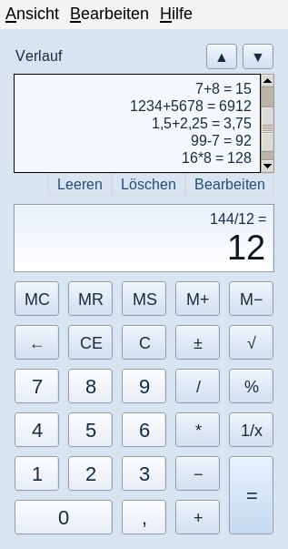 | **Standard: Rechtsklickmenü**<br>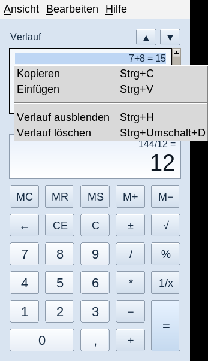 |
| **Englische Standardansicht**<br>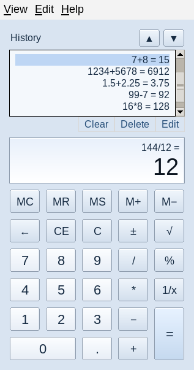 | **Ansicht → Sprache**<br>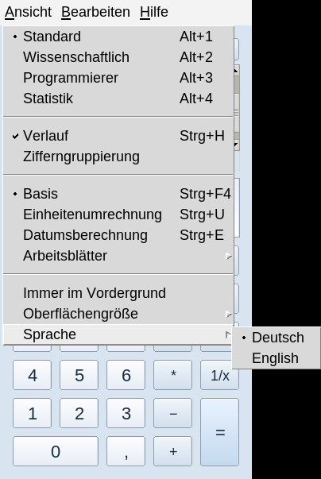 |
| **Standardmodus**<br>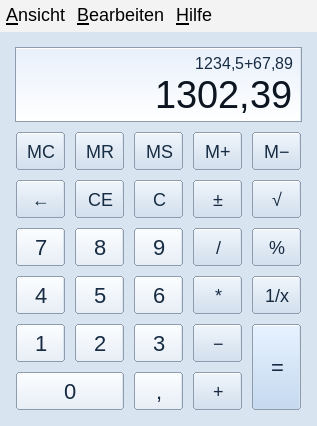 | **Wissenschaftlicher Verlauf**<br>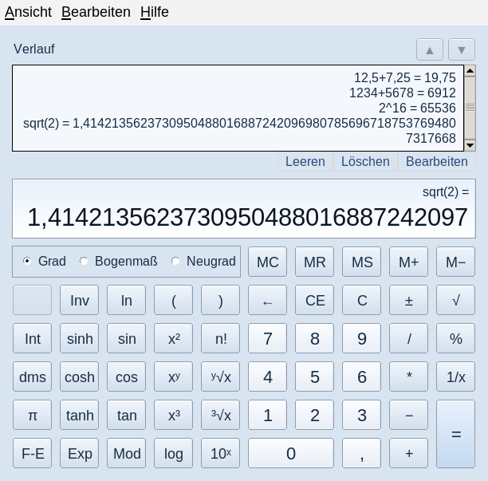 |
| **Wissenschaftlicher Modus**<br>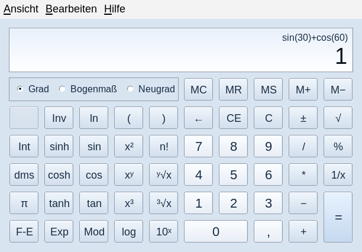 | **Wissenschaftliches Kontextmenü**<br>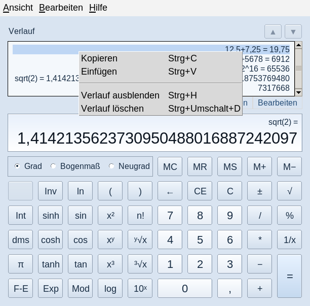 |
| **Programmierermodus**<br>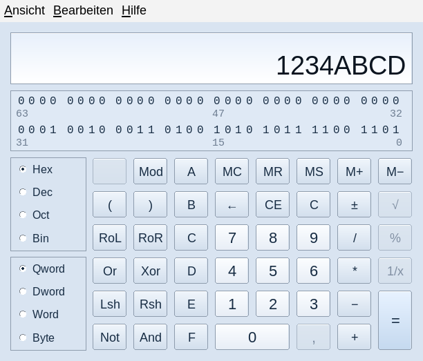 | **Einheitenumrechnung**<br>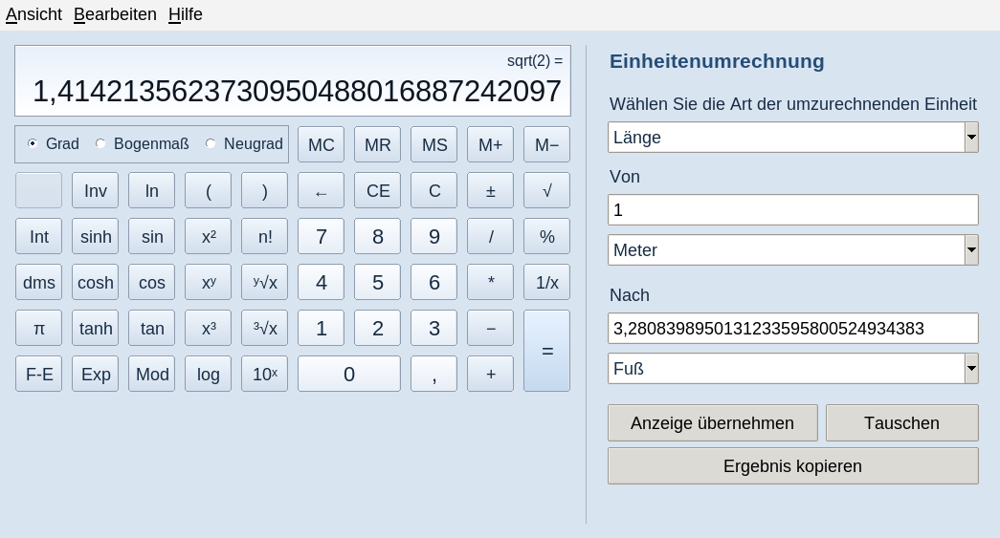 |
| **Statistikmodus**<br>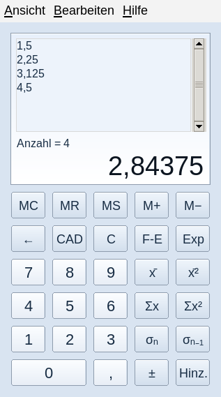 | **Datumsberechnung**<br>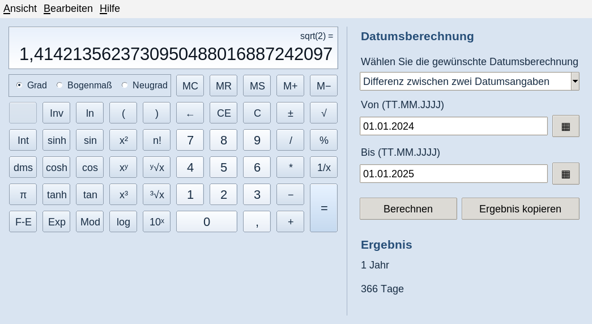 |
| **Inverse wissenschaftliche Funktionen**<br>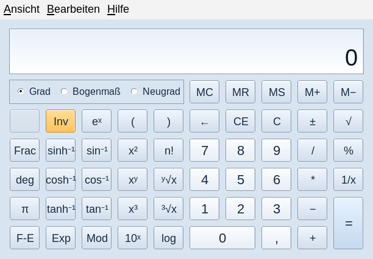 | **Hypothekenberechnung**<br>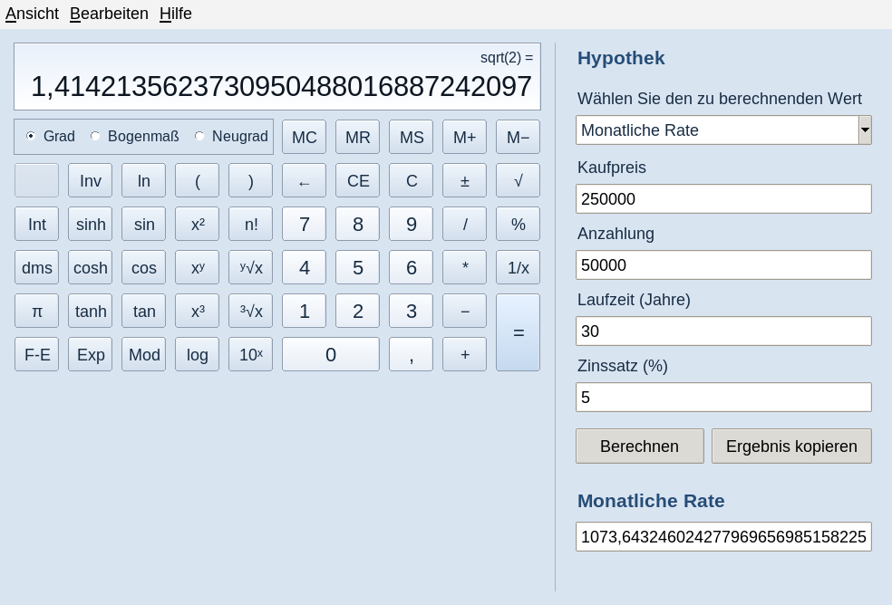 |

**Aktuelle Aufnahmen der laufenden Version 1.3.0 unter Linux/Tk, keine nativen
Windows-Screenshots und keine Grafikentwürfe.** Alle PNG-Dateien liegen in
`screenshots/`. Die Galerie steht unmittelbar unter der Hauptüberschrift;
README und Bilder gemeinsam ins Repository übernehmen.

Eigenständig entwickelte Nachbildung des klassischen Windows-7-Rechners als
Python/Tk-Anwendung für **Linux Mint x64 und Windows 10 x64**. Beide Projekte
verwenden denselben Anwendungscode. Microsofts `calc.exe` wird weder benötigt
noch ausgeführt oder mitgeliefert. Die klassische Tastenanordnung und der
Funktionsumfang der vorigen Ausgaben bleiben erhalten.

## Neu in 1.3.0

**Verlauf auch im Standardmodus rechtsbündig:** Öffnen über **Ansicht → Verlauf**
oder **Strg+H**, in Standard und Wissenschaftlich, auch bei umgebrochenen oder
markierten Zeilen und nach einem Sprach-/Größenwechsel. Der Verlauf bleibt
schreibgeschützt. Die Tests prüfen die tatsächlich gerenderten rechten Kanten,
nicht nur eine Widget-Einstellung.

**Rechtsklickmenü:** Auf einer Verlaufszeile, im freien Verlaufsbereich und in
der Kopfzeile stehen diese Aktionen bereit. Auch die Ergebnisanzeige besitzt
das Kontextmenü. **Umschalt+F10** bzw. die Menütaste öffnen es per Tastatur.

| Deutsch | English | Wirkung |
| :--- | :--- | :--- |
| Kopieren | Copy | Das volle Ergebnis des angeklickten/gewählten Eintrags kopieren; im Ergebnisdisplay dessen aktuellen Wert. |
| Einfügen | Paste | Zwischenablage in den Rechner übernehmen, nicht den Verlaufstext ändern. |
| Verlauf ausblenden | Hide history | Verlauf verbergen, alle Einträge erhalten. Bei verborgenem Verlauf: Verlauf einblenden / Show history. |
| Verlauf löschen | Clear history | Nur Einträge des aktuellen Standard-/wissenschaftlichen Modus löschen. |

**Zwei helle Pfeiltasten ▲ / ▼ oben rechts im Verlauf:** Sie blättern eine
sichtbare Textzeile nach oben/unten, einschließlich umgebrochener Zeilen. Sie
ändern weder Rechnung noch Auswahl und übernehmen keinen Wert. Am jeweiligen
Rand sind sie deaktiviert; bei leerem oder vollständig sichtbarem Verlauf sind
beide deaktiviert. Die Buttons verwenden helle, selbst gezeichnete Flächen,
keinen schwarzen Systemtheme-Hintergrund. Sie erscheinen bei eingeblendetem
Verlauf in Standard und Wissenschaftlich.

Für diese Änderung lag kein neuer Referenz-Screenshot vor. Position und Funktion
der beiden Pfeile sind daher als Auf-/Ab-Bildlaufsteuerung des Verlaufs umgesetzt,
nicht als verifizierte pixelgenaue Kopie einer unbekannten Referenz.

**Ansicht → Sprache → Deutsch / English:** Wechsel ohne Neustart; Rückweg in
Englisch: **View → Language → Deutsch**. Menüs, Kontextmenüs, Dialoge, Hilfe,
Einheiten, Kalender und Zahlenformate wechseln mit. Auch bereits geöffnete
Hilfefenster werden aktualisiert. Laufende Rechnung, Speicher, beide Verläufe,
Statistikwerte, Winkel-/Basis-/Wortbreitenwahl und Zusatzbereichseingaben bleiben
erhalten. Deutsch ist die Voreinstellung für neue und ältere Profile ohne
Sprachangabe. Die Auswahl wird gespeichert. Die Start-/Builddiagnosen und diese
Dokumentation sind weiterhin deutsch.

## Windows 10 x64: Quellcode starten

Den gesamten ZIP-Inhalt entpacken. Benötigt wird eine vollständige Python-
Installation ab 3.10 mit Tcl/Tk; der beiliegende EXE-Build ist auf **Python 3.10
bis 3.13 x64**, vorzugsweise **3.13 x64**, begrenzt. Im Python-Installer Tcl/Tk
und den Python Launcher aktivieren. Prüfung: `py -3.13 -m tkinter`.

**`Start.cmd` doppelklicken**, oder im Quellcodeordner:

```powershell
py -3.13 app.py
```

`Start-Konsole.cmd` zeigt Diagnoseausgabe. `app.pyw` bzw. `Start.cmd` starten ohne
dauerhaftes Konsolenfenster. Die optionale Einzeldatei benötigt ebenfalls Python/Tk:

```powershell
pyw -3.13 classic-calc-windows-1.3.0.pyzw
```

Alte Verknüpfungen oder heruntergeladene Einzeldateien auf den neuen Ordner bzw.
die neue Datei umstellen. **Hilfe → Info zum Rechner** muss Version 1.3.0 zeigen.
Die Lieferung enthält vollständigen Windows-Quellcode und Buildwerkzeuge,
**aber keine unter Windows gebaute EXE**. Ein nativer Windows-10-Test steht aus.

### Eigenständige Windows-EXE bauen

Im entpackten Projektordner **auf Windows x64**:

```powershell
.\build-windows.cmd
```

Das Skript erstellt `.venv-build`, installiert die festgelegte PyInstaller-
Version, führt die Tests aus, baut die EXE und prüft sie mit dem erweiterten
GUI-Selbsttest. Beim ersten Build ist Paketquellenzugriff nötig. Ohne zusätzliche
Parameter entsteht:

```text
dist/
    KlassischerRechner/
        KlassischerRechner.exe
        _internal/...
    KlassischerRechner-1.3.0-windows-x64-portable.zip
    KlassischerRechner-1.3.0-windows-x64-portable.zip.sha256
    windows-smoke-results.json
```

Den **gesamten Programmordner** weitergeben, nicht nur die EXE. Auf dem Zielrechner
ist danach kein separates Python erforderlich. Eine einzelne EXE wird mit
`.\build-windows.cmd --onefile` angefordert. `--offline` setzt eine vorbereitete
Buildumgebung voraus. `--skip-tests` überspringt die Test-Suite, nicht den
abschließenden EXE-Selbsttest. Die erzeugten EXEs sind nicht digital signiert.
Der Windows-Build kann nicht mit Linux-PyInstaller ausgeführt werden.

Die bisherige Windows-Anbindung bleibt erhalten: AppData, Unicode-Pfade,
AltGr-Mathematikzeichen, lokales Fehlerprotokoll und System-DPI-Awareness.
Es wird keine dynamische Per-Monitor-V2-Skalierung behauptet. Nach einem Wechsel
zu einem Monitor mit anderer Skalierung die Größe unter Ansicht anpassen oder
neu starten. System-Fensterrahmen und native Menüs können vom Linux-Bild abweichen.

## Linux Mint x64: Installation / Update

Alte Programmfenster schließen, dann im Downloadordner:

```sh
sudo apt install ./classic-calc_1.3.0_all.deb
classic-calc
classic-calc --version
```

Die Version muss **1.3.0** sein. Das Paket aktualisiert den bisherigen Paketnamen
`classic-calc`; Einstellungen bleiben am bisherigen Ort. `Architecture: all`
bedeutet architekturunabhängigen Python-Code und ist auch für x64 geeignet.
Abhängigkeiten: Python 3.10 oder neuer und Tk (`python3`, `python3-tk`).
Weder Wine noch Windows-Dateien, Compiler oder pip-Laufzeitpakete werden benötigt.
Der Desktopstarter heißt abhängig von der Desktop-Sprache „Klassischer Rechner“
oder „Classic Calculator“; die Anwendungssprache wird separat im Rechner gewählt.

Direkt aus dem vollständig entpackten Quellcode:

```sh
sudo apt install python3 python3-tk
cd classic-calc
python3 app.py
```

Alternativ `sh install.sh` für die bisherige Benutzerinstallation unter
`~/.local/share/classic-calc`; `sh uninstall.sh` entfernt nur diese Installation.
Bei paralleler Benutzer-/DEB-Installation zeigt `command -v classic-calc`,
welcher Starter verwendet wird. `/usr/bin/classic-calc --version` prüft gezielt
die DEB-Version. Veraltete `.pyz`-Dateien werden durch ein DEB-Update nicht ersetzt.

Einzeldatei mit vorhandenem Python/Tk:

```sh
python3 classic-calc-linux-1.3.0.pyz
```

## Zahlen, Datumsangaben und Datenbestand

| Einstellung | Deutsch | English |
| :--- | :--- | :--- |
| Dezimalzahl | `1234,56` | `1234.56` |
| Optionale Gruppierung | `1.234,56` | `1,234.56` |
| Datumsfeld | `TT.MM.JJJJ` | `YYYY-MM-DD` |
| Zwischenablage | Ungruppiert, Dezimalkomma | Ungruppiert, Dezimalpunkt |

Einfügen richtet sich nach der aktiven Sprache: `1,234` ist auf Deutsch 1,234,
auf Englisch 1234. In Deutsch bleibt ein einzelner Dezimalpunkt für technische
Eingaben zulässig: `1.234` bedeutet dann 1,234. Für deutsche Tausendergruppen
zusätzlich ein Dezimalkomma verwenden (`1.234,0`) oder die Gruppe weglassen.
Englische Gruppierungskommas müssen vollständige Dreiergruppen bilden;
`1,23` wird nicht stillschweigend umgedeutet. Punkt/Komma auf der Tastatur und
dem Ziffernblock sind in beiden Sprachen als Dezimaltaste nutzbar.

Beim Sprachwechsel werden Werte nicht neu berechnet oder gerundet: Rechenkern,
Speicher, Verlauf und gespeicherte Zahlen bleiben in kanonischer Darstellung;
nur die Präsentation wechselt. Datumsfelder akzeptieren in beiden Sprachen
auch die jeweils andere Form. Statistikimport: ein Wert pro Zeile oder
Trennung durch Leerzeichen/Semikolon, kein Komma als CSV-Spaltentrenner.
Der Export schreibt einen Wert pro Zeile im aktiven Zahlenformat.

Einstellungen einschließlich Sprache liegen in:

```text
Linux:   ~/.config/classic-calc/state.json
         bzw. $XDG_CONFIG_HOME/classic-calc/state.json
Windows: %APPDATA%\ClassicCalc\state.json
```

Alte Einstellungen aus 1.0.0/1.1.0/1.2.0 bleiben lesbar. Schema 2 und das
kanonische Zahlenformat bleiben erhalten; `language` (`de`/`en`) ist ein neues
optionales Feld. Verlauf ist nach Standard und Wissenschaftlich getrennt.
Bis zu 200 Verlaufseinträge und 10.000 Statistikwerte werden geladen.
`--fresh` liest und schreibt keine Einstellungen, auch keine Sprachwahl.
Ein Umzug zwischen Plattformen erfolgt bei geschlossenen Anwendungen durch
Kopieren von `state.json`; Zieldatei vorher sichern, kein automatisches Mischen.

Die Anwendung enthält keinen Netzwerkzugriff und keine Telemetrie. Ein lokales
`error.log` neben der Windows-Einstellungsdatei kann Startdiagnosen enthalten.
Nur separat gestartete Buildwerkzeuge laden Entwicklungsabhängigkeiten.

## Erhaltener Funktionsumfang

Standard, Wissenschaftlich, Programmierer, Statistik; Speicher, Verlauf,
Zwischenablage und Tastaturbedienung. Wissenschaftliche Funktionen umfassen
Potenzen, Wurzeln, Logarithmen, trigonometrische/hyperbolische Funktionen samt
Umkehrfunktionen, Klammern und Operatorrangfolge. Programmer: 8/16/32/64 Bit,
Binär/Oktal/Dezimal/Hex, Bitoperationen, Shifts, Rotationen und anklickbare Bits.
Zusatzbereiche: 97 Einheiten in 11 Kategorien, Datum sowie Hypotheken-,
Fahrzeugleasing- und Kraftstoffverbrauchs-Arbeitsblätter. F1 öffnet die Hilfe
in der gewählten Sprache. Rechenkern, Mathematik und Zusatzberechnungen wurden
gegenüber Version 1.2.0 nicht verändert.

## Kommandozeile und Entwicklung

```sh
python3 app.py --fresh --mode standard --language de --scale 1.5
python3 app.py --language en --eval '1,234.5 + 2.5'
python3 app.py --language de --eval '1.234,5 + 2,5'
python3 app.py --version
```

Unter Windows `python3` durch `py -3.13` ersetzen. `--language de|en` überschreibt
die gespeicherte Auswahl für den Start; im normalen GUI-Betrieb wird die Auswahl
anschließend gespeichert. `--eval` nutzt keine Einstellungen, nimmt ohne Option
Deutsch an und gibt für Skripte immer einen Dezimalpunkt aus. `--mode` verwendet
weiterhin `standard`, `scientific`, `programmer`, `statistics`.

```sh
xvfb-run -a python3 -m unittest discover -v
python3 tools/verify_precision.py
xvfb-run -a python3 app.py --smoke-test build/source-smoke.json
sh build-deb.sh dist
python3 tools/build_zipapp.py dist/classic-calc-linux-1.3.0.pyz
python3 tools/build_zipapp.py dist/classic-calc-windows-1.3.0.pyzw --windowed
```

Unter Windows führt `Test.cmd` die Suite auf einem interaktiven Desktop aus.
Pillow ist nur für `tools/capture_screenshots.py` nötig; mpmath nur für den
unabhängigen Präzisionsvergleich. Beides sind keine Laufzeitabhängigkeiten.

## Verifikation und Grenzen

**311 automatisierte Tests bestanden, darunter 104 GUI-Tests; zusätzlich 350
unabhängige numerische Prüfungen.** Enthalten sind echte Tk-Maus-/Tastaturereignisse,
gerenderte Standard-Rechtsausrichtung bei 75–300 % Größe, umgebrochene/markierte
Zeilen, Kontextbefehle, Pfeilgrenzen und DE/EN-Rundreisen mit erhaltenem Zustand.
Der Paket-Selbsttest prüft zusätzlich Navigation und Sprache in der gebündelten
Anwendung. Rohprotokolle und Details stehen in `TEST_REPORT.md`, `test-results.txt`,
`precision-results.txt` und `verification/`.

Tests liefen unter **Debian 13 x86-64, Python 3.13.5, Tk 8.6.16 und Xvfb**,
nicht auf einem nativen Linux-Mint- oder Windows-10-Desktop. Ein Windows-Build
wurde hier nicht ausgeführt. Unter Windows wird im unbeaufsichtigten Popup-Test
nur das modale native Öffnen ersetzt; Menükonstruktion und Aktionen bleiben echt.
Ein echter Rechtsklick auf Windows ist daher vor Veröffentlichung manuell zu prüfen.

Dies ist weiterhin eine eigenständige Nachbildung, keine verifizierte pixel- und
funktionsidentische Kopie von Microsofts Rechner. Fensterrahmen, Schriftarten,
Barrierefreiheit und numerische Grenzfälle können abweichen. Die Finanzarbeitsblätter
sind vereinfachte Rechenmodelle, keine Finanzierungsangebote. Historische Notizen
liegen unter `docs/archive/`; sie sind keine Prüfberichte dieser Version.
