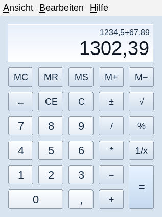
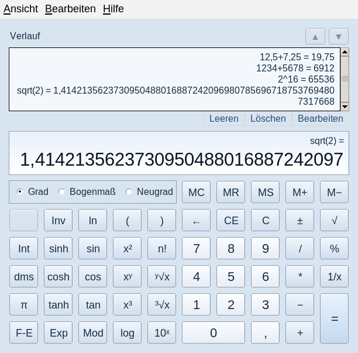
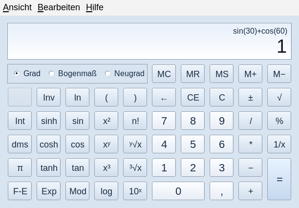
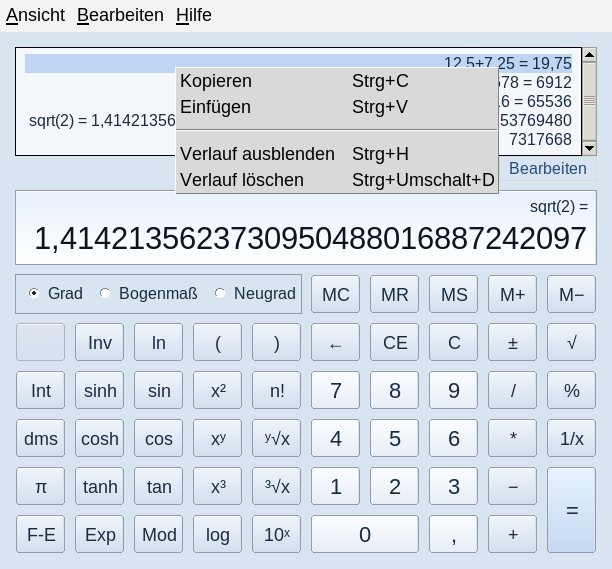
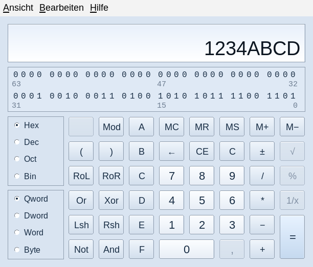
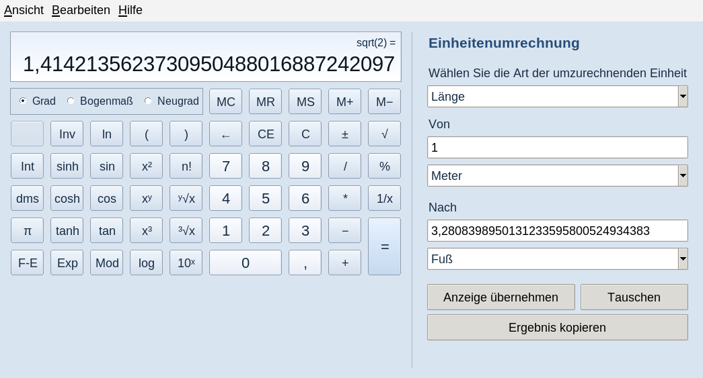
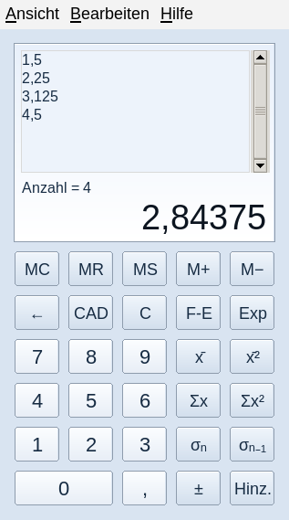
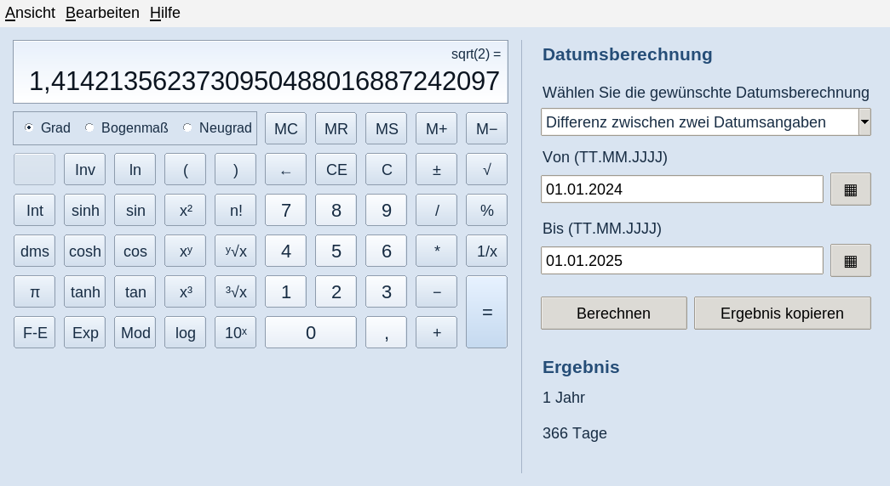
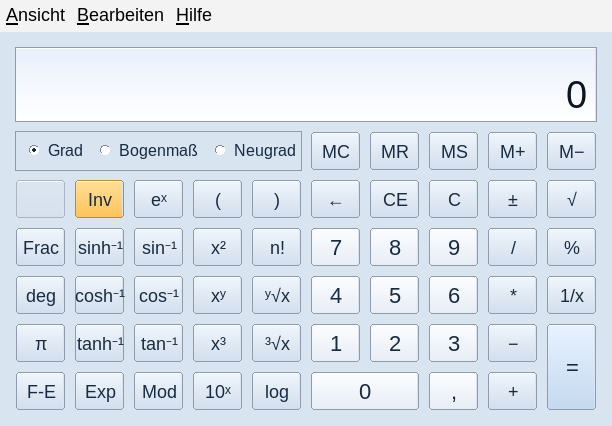
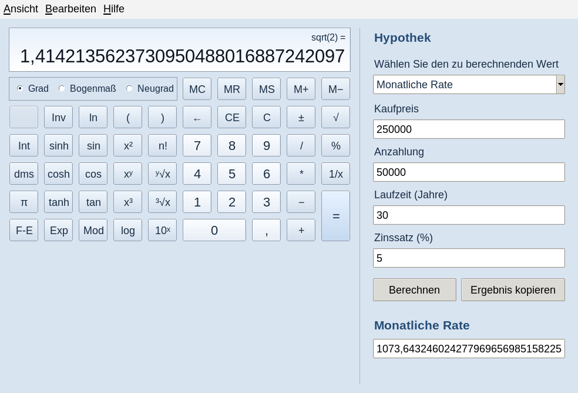

# Klassischer Rechner 1.1.0 – deutsche Linux-Version

| Rechnermodi | Verlauf und Zusatzfunktionen |
| :---: | :---: |
| **Standardmodus**<br> | **Rechtsbündiger Verlauf**<br> |
| **Wissenschaftlicher Modus**<br> | **Kontextmenü des Verlaufs**<br> |
| **Programmierermodus**<br> | **Einheitenumrechnung**<br> |
| **Statistikmodus**<br> | **Datumsberechnung**<br> |
| **Inverse wissenschaftliche Funktionen**<br> | **Hypothekenberechnung**<br> |

Eigenständig entwickelte Nachbildung des klassischen Windows-7-Rechners als
native Python/Tk-Anwendung. Die Windows-Datei `calc.exe` wird nicht benötigt,
nicht ausgeführt und nicht mitgeliefert. Zielplattform ist Linux Mint x64.

## Änderungen in 1.1.0

Die Oberfläche ist jetzt auf Deutsch: Menüs, Modusnamen, Zusatzbereiche,
Einheiten, Kalender, Fehlermeldungen, Hilfetexte und Anwendungseintrag.
Die Anzeige verwendet ein Dezimalkomma; die Dezimaltaste ist entsprechend
beschriftet. Mathematische Funktionskürzel und interne Dateibezeichner bleiben
unverändert.

**Der Verlauf ist rechtsbündig**, unabhängig davon, ob er über
**Ansicht > Verlauf** oder **Strg+H** geöffnet wird. Lange Berechnungen werden
rechtsbündig umgebrochen, statt abgeschnitten zu werden. Der Verlauf besitzt
eine vertikale Bildlaufleiste und bleibt schreibgeschützt.

Ein **Rechtsklick auf den Verlauf** bietet:

- **Kopieren**: Ergebnis des angeklickten Eintrags in voller interner Genauigkeit.
- **Einfügen**: Zwischenablage in den Rechner übernehmen, nicht in die Verlaufszeile.
- **Verlauf ausblenden**: Ansicht schließen, ohne Einträge zu entfernen.
- **Verlauf löschen**: alle Verlaufseinträge des aktuellen Rechnermodus entfernen.

Auch die Ergebnisanzeige bietet die Verlaufskommandos im Kontextmenü. Bei
verborgenem Verlauf erscheint dort „Verlauf einblenden“. Im Programmierer- und
Statistikmodus sind die nicht unterstützten Verlaufskommandos deaktiviert.
Umschalt+F10 oder die Menütaste öffnen das Kontextmenü per Tastatur.

## Installation oder Update mit dem Debian-Paket

Die bisherige Anwendung zuerst schließen. Im Downloadverzeichnis ausführen:

```sh
sudo apt install ./classic-calc_1.1.0_all.deb
classic-calc
```

Im Anwendungsmenü erscheint **Klassischer Rechner**. Da Paketname und
Konfigurationspfad unverändert sind, aktualisiert dieses Paket Version 1.0.0.
`Architecture: all` bedeutet architekturunabhängiges Python; das Paket ist auch
für x64 vorgesehen. Benötigt werden Python 3.10 oder neuer und Tk. Die
Paketabhängigkeiten sind `python3 (>= 3.10)` und `python3-tk`.

Die Anwendung selbst benötigt weder Wine noch Windows-Dateien, Compiler oder
zusätzliche pip-Pakete. Die Installation der Systemabhängigkeiten über apt kann
einen Zugriff auf die eingerichteten Paketquellen benötigen.

## Direkt aus dem Quellcode starten

```sh
sudo apt install python3 python3-tk
cd classic-calc
python3 app.py
```

Alternativ installiert `./install.sh` nur für den aktuellen Benutzer nach
`~/.local/share/classic-calc` und erstellt einen Starter unter `~/.local/bin`.
`./uninstall.sh` entfernt ausschließlich diese Benutzerinstallation; die
Einstellungen bleiben erhalten. Das Debian-Paket wird mit
`sudo apt remove classic-calc` entfernt.

Die einzelne Python-Anwendungsdatei wird so gestartet:

```sh
python3 classic-calc-de-1.1.0.pyz
```

Auch diese Datei benötigt das Systempaket `python3-tk`.

## Funktionsumfang

Standard-, wissenschaftlicher, Programmierer- und Statistikmodus; Speicher,
Verlauf, Zwischenablage und Tastaturbedienung. Wissenschaftliche Funktionen
umfassen Potenzen, Wurzeln, Logarithmen, trigonometrische und hyperbolische
Funktionen mit Umkehrfunktionen, Klammern und Operatorrangfolge.

Der Programmierermodus unterstützt 8/16/32/64 Bit, Binär/Oktal/Dezimal/Hex,
Bitoperationen, Verschiebungen, Rotationen und eine anklickbare Bitanzeige.
Zusatzbereiche: 97 Einheiten in 11 Kategorien, Datumsberechnungen sowie
Arbeitsblätter für Hypothek, Fahrzeugleasing und Kraftstoffverbrauch.

F1 öffnet die deutsche Hilfe mit Bedienung, Rechenregeln und Tastenkürzeln.

## Zahlen und Datumsangaben

Die Darstellung erfolgt mit Dezimalkomma, optional mit Punkt als
Tausendertrennzeichen: `1.234,56`. Kopieren liefert den ungruppierten Wert,
beispielsweise `1234,56`, mit voller interner Genauigkeit. `1,234` bedeutet bei
der Eingabe **1,234**, nicht 1234.

Für alte Einstellungen und technische Eingaben wird auch ein einzelner
Dezimalpunkt akzeptiert. Daher bedeutet die mehrdeutige Eingabe `1.234`
**1,234**. Für deutsche Tausendergruppen verwenden Sie ein zusätzliches
Dezimalkomma (`1.234,0`) oder lassen den Gruppierungspunkt weg (`1234`).
`1.234,56 + 2,5` wird ebenfalls akzeptiert. Eingaben werden ausschließlich vom
arithmetischen Parser verarbeitet; es gibt kein Python-eval/exec.

Datumsfelder akzeptieren `TT.MM.JJJJ` und `JJJJ-MM-TT`. Der Kalender zeigt
deutsche Monats- und Wochentagsnamen. Die Ergebnisbeschreibung ist deutsch.

Statistikimport: ein Wert pro Zeile oder Trennung durch Leerzeichen bzw.
Semikolon. Dezimalkomma und Dezimalpunkt werden akzeptiert. Ein Komma ist in
dieser deutschen Version **kein CSV-Spaltentrenner**. Beispiel:

```text
1,5;2,25
3,125
```

Statistikexport schreibt einen Wert mit Dezimalkomma pro Zeile.

## Einstellungen und vorhandene Daten

Speicherort: `~/.config/classic-calc/state.json` bzw.
`$XDG_CONFIG_HOME/classic-calc/state.json`. Der Verlauf bleibt getrennt nach
Standard- und wissenschaftlichem Modus. Bis zu 200 Verlaufseinträge und
10.000 Statistikwerte werden geladen.

Gespeicherte Einstellungen aus Version 1.0.0 werden übernommen. Interne
Modus-/Einheitskennungen und volle Zahlenwerte bleiben sprachunabhängig.
Eingaben der alten Einheitenumrechnung und Arbeitsblätter werden nach den
bisherigen Dezimal-/Gruppierungsregeln eingelesen. Neue Dateien verwenden
Schema 2 mit explizitem kanonischem Zahlenformat. Das Laden alter Daten,
Komma-Gruppierung in alten Arbeitsblättern und erneutes Speichern sind getestet.

`--fresh` verhindert das Lesen und Schreiben der Einstellungen. Die Anwendung
hat keinen Netzwerkzugriff und keine Telemetrie.

## Kommandozeile

```sh
python3 app.py --fresh --mode scientific --scale 1.5
python3 app.py --eval '1,5 + 2,25'
python3 app.py --version
```

Die stabilen Werte für `--mode` bleiben `standard`, `scientific`, `programmer`
und `statistics`. `--eval` akzeptiert deutsche Eingaben und gibt für die
Weiterverarbeitung in Skripten weiterhin einen **Dezimalpunkt** aus.
`--scale` reicht von 0.75 bis 3.0; das Menü bietet feste Skalierungsstufen.

## Tests und Neubau

```sh
xvfb-run -a python3 -m unittest discover -v
./build-deb.sh ./dist
python3 tools/build_zipapp.py ./dist/classic-calc-de-1.1.0.pyz
```

Die GUI-Tests benötigen einen Bildschirm oder Xvfb. Der optionale unabhängige
Präzisionsvergleich benötigt mpmath; `tools/capture_screenshots.py` benötigt
Pillow und X11. Beides sind reine Entwicklungswerkzeuge, keine
Laufzeitabhängigkeiten der Anwendung.

**216 Tests bestanden**, darunter 52 GUI-Tests. Zusätzlich bestanden
350 unabhängige numerische Prüfungen. Details stehen in `TEST_REPORT.md`,
Rohdaten in `test-results.txt`. Die Bilder unter `screenshots/` stammen aus der
laufenden deutschen Anwendung, nicht aus einem Grafikentwurf.

## Grenzen

Die Tests erfolgten unter x86-64 Debian 13 mit Tk/Xvfb, nicht in einer
Linux-Mint-Installation. Die Original-Windows-Datei wurde nicht zum direkten
Funktionsvergleich ausgeführt. Es handelt sich weiterhin um eine Nachbildung,
nicht um einen verifizierten pixel- und funktionsidentischen Klon. Linux-
Fensterrahmen, Schriftwiedergabe, Barrierefreiheit und numerische Grenzfälle
können abweichen. Die Hypotheken-/Leasingarbeitsblätter sind vereinfachte
Rechenmodelle und keine Finanzierungsangebote.
